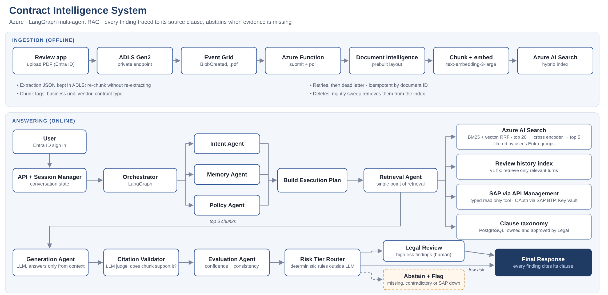

# Contract Intelligence on Azure

A contract review system on Azure, measured against lawyer-labelled ground truth. The ingestion pipeline and a first answering path run end to end today: it reads contracts, finds the clauses that matter, answers with verbatim citations checked in code, and says "not found" or abstains instead of guessing. Next comes identity: an API that takes the user's groups only from a validated Entra ID token. The multi-agent orchestration (intent, memory and policy agents in LangGraph) follows behind that API, so no agent ever runs without a verified user.

This is my own reconstruction of an enterprise architecture pattern, built on a $100 student subscription. Every tradeoff is an [architecture decision record](docs/adr/), every failure is in the [build log](docs/build-log.md), and every claim below is a measurement.

## Results so far

| | Measured | How |
|---|---|---|
| **Corpus** | 50 contracts, 1,526 pages, 1,238 chunks, 27 contract types | [CUAD](docs/adr/0002-cuad-as-corpus-and-ground-truth.md), stratified by length ([ADR-0015](docs/adr/0015-document-intelligence-tier.md)) |
| **Extraction cost** | $15.26, matching the projection to the cent | Corpus measured before choosing a tier |
| **Upload to searchable** | 23 s (short contract) | Event Grid → queue → Function ([ADR-0018](docs/adr/0018-queue-between-event-grid-and-function.md)) |
| **Access control** | Upload without access groups refused and parked; search refuses to run without the caller's groups; leakage test (enumerate, targeted, adversarial, injection probes) must find 0 leaks | Tested live and in unit tests ([ADR-0013](docs/adr/0013-identity-and-security-trimming.md), [ADR-0023](docs/adr/0023-entitlements-from-validated-token.md), `eval/leakage_test.py`) |
| **System of record** | Reachable only through API Management; credentials resolved from Key Vault by managed identities; no secret in code or config | Live access tests ([ADR-0010](docs/adr/0010-system-of-record-as-typed-tool.md)) |
| **Retrieval** | Labelled clause in the top 5: **95%** (typical 99%, long 91%, very long 84%) | 500 queries vs CUAD labels ([baseline](eval/results/baseline-slice1-retrieval.md)) |
| **Answers** (current configuration) | Clauses found **90 to 91%**; quote matches the lawyers' text **96 to 98%**; absent clauses reported correctly **80 to 81%**; fabricated quotes reaching a reviewer: **0** in every run | 200 questions ([run](eval/results/run-v3-neutral.md)); first configuration found 97% but reported only 70% of absent clauses correctly ([baseline](eval/results/baseline-slice1-answers.md)) |
| **Known weakness** | **Consistency:** the same question gets a different outcome about 1 time in 11 (9% of 200 answers changed between two identical runs, measured twice). Next: three samples per question, answer only when they agree, otherwise route to a reviewer | [A/A tests](eval/results/noise-floor-v3.md), [ADR-0022](docs/adr/0022-agreement-across-samples.md) |
| **Spend to date** | about $16 of $100 | [Cost log](docs/cost-log.md) |



## What runs today

**Ingestion.** A PDF uploaded to the data lake's `inbox/` raises an Event Grid event, which is written to a storage queue and processed by a Flex Consumption Function: Document Intelligence layout extraction (cached), cleaning, paragraph-filled 800-token chunks with page numbers, 1,024-dimension embeddings, and a push to AI Search with access groups on every chunk. Failures retry, then park in a poison queue. No keys anywhere: every hop uses a managed identity.

**Answering (slice 1, [ADR-0019](docs/adr/0019-vertical-slice-before-components.md)).** Hybrid search (BM25 + vector, RRF) reranked by the semantic ranker, filtered by the caller's groups. The model returns a determination and verbatim quotes; code drops any finding whose quote is not in the clause it cites ([ADR-0020](docs/adr/0020-deterministic-citation-check-first.md)) and routes the result: answered, not found, or abstain.

```powershell
python -m agents.ask "What law governs this agreement?" --doc bdb7d1532a642920
# [ANSWERED]  Delaware ... [C1 valid] DigitalCinemaDestinations... p.30-31: "governed by the internal laws of the State of Delaware..."
```

## Lessons the measurements taught

- **A retrieval score cannot tell you a clause is missing.** Reranker scores for present and absent clauses overlap almost completely, so absence is judged by the model reading the evidence, not by a threshold ([ADR-0009](docs/adr/0009-deterministic-rules-and-abstention.md)).
- **Run the same thing twice before believing a difference.** Two identical runs changed 9% of answers, and one identical comparison even came out "statistically significant". That overturned two of my own earlier conclusions and exposed the real weakness: consistency ([A/A tests](eval/results/noise-floor-v3.md)).
- **Test your own hypotheses, including the flattering ones.** I suspected the first configuration's 97% was inflated by a bug; checking each answer showed it was real, and that strict wording had cost 8 correct detections ([analysis](eval/results/run-v3-neutral.md)).
- **Change one variable at a time, and weight errors by their cost.** Bundling a format fix with a prompt tweak cut false claims but quadrupled missed clauses, and the run could not say which change did which. A missed clause is silent; a false claim comes with a citation a reviewer can reject ([run](eval/results/run-v2-strict.md)).
- **Read the errors before fixing them.** The 23 "false claims" were mostly the model saying "No" and citing evidence for it, which my routing counted as "yes". The fix was the output contract, not an extra model call ([ADR-0021](docs/adr/0021-determination-separate-from-evidence.md)).
- **A cheap sample is not a valid sample.** A median-length evaluation set would have reported 99% retrieval and hidden the drop to 84% on very long contracts ([ADR-0015](docs/adr/0015-document-intelligence-tier.md)).
- **Pace under rate limits, do not retry into them.** One guardrail for every deployment broke the batch; limits are now set per workload ([ADR-0014](docs/adr/0014-model-deployment-type-and-model-roles.md)).
- **Measure the platform's limits before designing around them.** Event Grid waits 30 seconds; 31 of 48 contracts took longer, so a queue sits between them ([ADR-0018](docs/adr/0018-queue-between-event-grid-and-function.md)).

## Roadmap

| Step | Scope | Status |
|---|---|---|
| Foundation | Subscription constraints, data lake, Document Intelligence, models, search index | Done |
| Ingestion | Pipeline library, batch over evaluation set, event-driven Function, health check | Done |
| Slice 1 | Retrieval agent, cited answers, citation check, routing, retrieval and answer evaluation | Done; output-format fix being measured |
| Azure services | PostgreSQL taxonomy (Entra-only auth, approval, managed-identity DB role); Key Vault + API Management + mock SAP with a typed, fail-closed vendor tool | Done |
| Entitlements | Leakage test with a zero-leak pass mark; rule that groups come only from the validated token ([ADR-0023](docs/adr/0023-entitlements-from-validated-token.md)) | Leakage test PASS (0 leaks, 260 probes); token check built ([ADR-0024](docs/adr/0024-identity-tenant-and-app-roles.md)) |
| **Identity first** | Separate identity tenant, app roles, test clients and users (`infra/08-identity.ps1`); API that validates the Entra ID token and maps roles to groups (`api/`); 22 unit tests; image built in GitHub Actions with OIDC (no stored secret), tests gate the build; deployed to Container Apps with separate pull and runtime identities ([ADR-0025](docs/adr/0025-api-on-container-apps.md)); smoke test with real tokens PASS against the deployed API | Done |
| Then | LangGraph orchestrator behind that API: retrieval, taxonomy and the vendor tool, each tool checked against the signed-in user's entitlements; abstain when the vendor system is unavailable | |
| Then | Review app with Entra sign-in; review history carrying source access tags; leakage test as a deployment gate; private endpoints; Bicep for everything | |
| Parked, ready to run | Three-sample agreement ([ADR-0022](docs/adr/0022-agreement-across-samples.md)), definitions in prompts, LLM judge, reranker comparison | |

## How to read this repo

| If you want | Go to |
|---|---|
| Why each part is built the way it is | [`docs/adr/`](docs/adr/): one decision record per tradeoff, with the evidence |
| What broke and how it was diagnosed | [`docs/build-log.md`](docs/build-log.md) |
| The measured baselines | [`eval/results/`](eval/results/) |
| How the pieces connect | [`docs/architecture/overview.md`](docs/architecture/overview.md) |
| What it costs | [`docs/cost-log.md`](docs/cost-log.md) |

## Decision index

| ADR | Decision | Status |
|---|---|---|
| [0001](docs/adr/0001-public-first-harden-later.md) | Build on public endpoints with Entra auth, harden in a dedicated phase | Accepted |
| [0002](docs/adr/0002-cuad-as-corpus-and-ground-truth.md) | Use CUAD as the contract corpus and evaluation ground truth | Accepted |
| [0003](docs/adr/0003-model-hosting-under-subscription-constraints.md) | Host the models on the student subscription, in Canada Central | Accepted |
| [0004](docs/adr/0004-push-ingestion-over-indexer.md) | Event-driven push ingestion instead of an AI Search indexer | Accepted |
| [0005](docs/adr/0005-fixed-size-chunking-v1.md) | Paragraph-filled 800-token chunks in v1; clause-aware chunking as a measured experiment | Accepted |
| [0006](docs/adr/0006-hybrid-retrieval-and-reranking.md) | Hybrid retrieval with RRF, then rerank from top 20 to top 5 | First stage Accepted; reranker comparison pending |
| [0007](docs/adr/0007-langgraph-orchestration.md) | LangGraph for orchestration instead of a managed agent service | Accepted |
| [0008](docs/adr/0008-review-history-as-retrieval.md) | Review history retrieved from its own index, not appended to the prompt | Proposed |
| [0009](docs/adr/0009-deterministic-rules-and-abstention.md) | Rules and routing in code; a retrieval score cannot decide absence | Accepted, revised |
| [0010](docs/adr/0010-system-of-record-as-typed-tool.md) | Vendor system of record reached through APIM as a typed, read-only tool | Accepted |
| [0011](docs/adr/0011-clause-taxonomy-store.md) | Governed clause taxonomy in PostgreSQL, Entra-only auth, versioned draft → approved | Accepted |
| [0012](docs/adr/0012-evaluation-method.md) | Clause-level evaluation against labelled ground truth, with a calibrated LLM judge | Proposed |
| [0013](docs/adr/0013-identity-and-security-trimming.md) | Entra identities everywhere, no keys, results filtered by the user's groups | Accepted |
| [0014](docs/adr/0014-model-deployment-type-and-model-roles.md) | GlobalStandard deployments; capacity set per workload | Accepted, revised |
| [0015](docs/adr/0015-document-intelligence-tier.md) | Paid extraction tier, stratified 50-contract evaluation set extracted once | Accepted |
| [0016](docs/adr/0016-search-tier-and-vector-size.md) | AI Search Free tier, 1,024-dimension vectors, vectors not stored | Accepted |
| [0017](docs/adr/0017-pipeline-as-library.md) | Ingestion pipeline as a library with two thin callers | Accepted |
| [0018](docs/adr/0018-queue-between-event-grid-and-function.md) | Storage queue between Event Grid and the Function | Accepted, revised |
| [0019](docs/adr/0019-vertical-slice-before-components.md) | Thin answering slice end to end before the remaining components | Accepted |
| [0020](docs/adr/0020-deterministic-citation-check-first.md) | Deterministic citation check first; LLM judge only for entailment | Accepted |
| [0021](docs/adr/0021-determination-separate-from-evidence.md) | Determination separate from cited evidence; code routes on it | Accepted (format); wording effects not established |
| [0022](docs/adr/0022-agreement-across-samples.md) | Three samples per question; answer only on agreement, otherwise route to a reviewer | Proposed |
| [0023](docs/adr/0023-entitlements-from-validated-token.md) | Entitlements come only from the validated token; leakage is a zero-tolerance regression test | Accepted |
| [0024](docs/adr/0024-identity-tenant-and-app-roles.md) | Separate identity tenant; app roles mapped to search groups; two gates (Entra, then the API) | Accepted |
| [0025](docs/adr/0025-api-on-container-apps.md) | API on Container Apps: managed identity, no registry password, read-only roles, scale to zero | Accepted |

**Proposed** means the decision waits for evidence from the step where it applies. An ADR moves to Accepted only with a measurement or a test result behind it.

## Repo layout

```
infra/       az CLI and ARM scripts, one per phase (Bicep in a later step)
ingestion/   pipeline library, batch script, queue-triggered Function, unit tests
agents/      retrieval agent, answering and routing, ask CLI, taxonomy lookup, typed system-of-record tool, unit tests
eval/        evaluation set, retrieval and answer evaluations, baselines in eval/results/
taxonomy/    governed clause taxonomy: schema, Entra-token connection, CUAD seed, approval, identity grants
sap-mock/    mock SAP vendor master (separate Function app behind API Management)
docs/        ADRs, architecture overview, build log, cost log, interview notes
```

## Run it

Requires Python 3.12, the Azure CLI signed in (`az login`), and the resources from `infra/`. Contracts are not in the repo: download [CUAD v1](https://zenodo.org/records/4595826) separately.

```powershell
python -m venv .venv; .\.venv\Scripts\Activate.ps1
pip install -r ingestion\requirements-dev.txt
python -m pytest -q agents\tests ingestion\tests
python ingestion\batch_ingest.py --cuad-root <folder containing CUAD_v1> --limit 1
python -m agents.ask "What law governs this agreement?" --doc <doc_id>
python eval\answer_eval.py --cuad-root <folder containing CUAD_v1>
```
