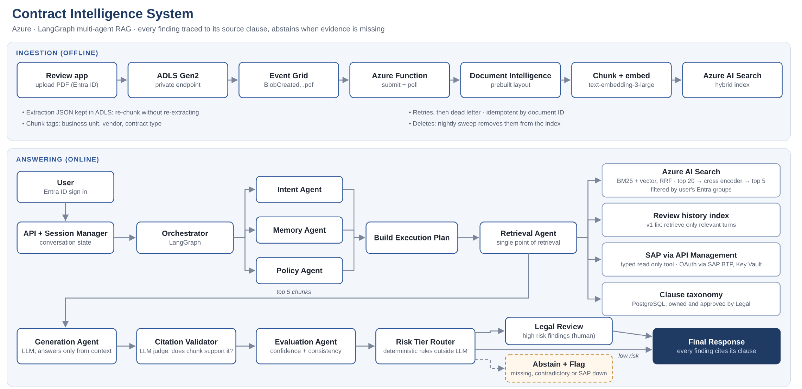

# Architecture overview

## Two paths

**Ingestion (offline).** A reviewer uploads a PDF through the review app, which writes it to ADLS Gen2 with its managed identity. Event Grid fires on `BlobCreated` for `.pdf` files and triggers a Function. The Function submits the file to Document Intelligence (prebuilt layout), polls for the result, saves the extraction JSON back to ADLS, chunks it, embeds each chunk, tags it with access metadata and pushes it to AI Search.

**Answering (online).** A signed-in user asks a question. The orchestrator fans out to three agents in parallel: intent (what is being asked), memory (relevant earlier turns) and policy (which rules apply). Their outputs join into an execution plan. The retrieval agent is the only component that touches data: hybrid search filtered by the user's groups, review history, the vendor system of record and the clause taxonomy. The top 5 chunks go to generation, then citation validation, then evaluation, then a deterministic risk router that sends each finding to the final response, legal review, or abstain and flag.

## Component map

| Diagram box | Azure service | Code location | Phase | ADR |
|---|---|---|---|---|
| Review app | Container Apps | `api/` | 11 | 0013 |
| ADLS Gen2 | Storage account, hierarchical namespace | `infra/` | 1 | 0001 |
| Event Grid | System topic on the storage account | `infra/` | 5 | 0004 |
| Azure Function | Functions (Flex Consumption) | `ingestion/` | 5 | 0004 |
| Document Intelligence | AI Document Intelligence, prebuilt layout | `ingestion/` | 2 | |
| Chunk + embed | Azure OpenAI embedding deployment | `ingestion/` | 3, 5 | 0003, 0005 |
| Azure AI Search | AI Search | `infra/`, `agents/` | 4 | 0006, 0013 |
| Orchestrator and agents | LangGraph on Container Apps | `agents/` | 8, 9 | 0007, 0009 |
| Review history index | AI Search (second index) | `agents/` | 10 | 0008 |
| Vendor system of record | APIM Consumption + mock vendor Function, Key Vault | `infra/`, `agents/tools/` | 7 | 0010 |
| Clause taxonomy | PostgreSQL Flexible Server or repo YAML | `agents/` | 6 | 0011 |
| Evaluation | Local harness | `eval/` | 12 | 0012 |

## Non-functional targets (to be measured, not assumed)

| Quality | Target for this build | Measured in |
|---|---|---|
| Ingestion | One contract indexed within 2 minutes of upload | Phase 5 |
| Answer latency | p95 under 15 seconds per question | Phase 12 |
| Cost | Token cost per contract review reported, not estimated | Phase 12 |
| Safety | Zero chunks returned outside the user's groups | Phase 11 test |
| Reliability | Reprocessing a document never creates duplicates | Phase 5 test |
